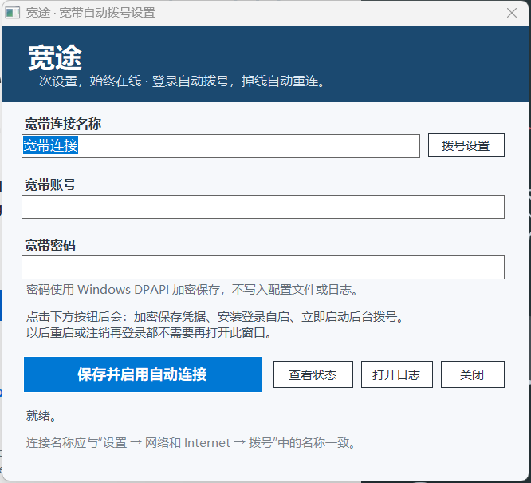

# 宽途 KuanTu

> 一次设置，始终在线。


**宽途（KuanTu）** 是一个面向 Windows 11 的 PPPoE 自动拨号小工具。它把“每次开机手动点连接”变成一次设置：

- 登录 Windows 后自动拨号；
- 掉线后自动重连；
- 宽带账号密码用 Windows DPAPI 加密保存；
- 整个过程静默运行，不弹 PowerShell 窗口。

不装驱动、不装运行时、不修改 DNS/防火墙，整个目录约 210 KB，复制到任意文件夹即可使用。

## 下载安装（推荐）

直接下载单文件安装器：

**[KuanTu-Setup.exe](dist/KuanTu-Setup.exe)**

- 约 97 KB
- 双击运行即可，无需解压
- 自动安装到 `%LOCALAPPDATA%\KuanTu`
- 不需要管理员权限

SHA-256：

```text
8B0BFAACF95CEB12BF9A55D1C53BC6CDA2A2E4FE9AEAC5B4A47B26D2375209A9
```

## 关于宽途

“宽”取自**宽带**，“途”寓意**一路畅通**。

希望宽带像水和电一样：打开电脑，它已经在线；线路抖动，它自己恢复。你不需要记住拨号按钮在哪里，也不需要每次开机重复输入账号密码。

### 它解决什么问题

| 日常麻烦 | 宽途的做法 |
|---|---|
| 开机后要手动点“宽带连接” | 登录 Windows 后自动拨号 |
| 网络断了没人管 | 状态轮询 + 指数退避自动重连 |
| 密码不想明文写在脚本里 | DPAPI 加密，只对当前 Windows 用户有效 |
| 不会用 PowerShell | 双击图形界面，填一次账号密码即可 |
| 小工具装一堆运行时 | 只用 Windows 自带组件，约 210 KB |
| 卸载后残留一堆东西 | 一条命令取消自启并清理凭据/日志 |

### 适合谁

- Windows 11 家庭宽带用户，尤其是 PPPoE 拨号（光猫桥接）场景；
- 小型工作室、宿舍、出租屋等需要“开机即在线”的机器；
- 想参考 RAS API / DPAPI / 计划任务实现方式的开发者。

### 它不做什么

- 不修改 DNS、代理、防火墙、MTU、VLAN；
- 不创建或删除运营商账号；
- 不绕过运营商认证，不做账号共享；
- 不申请管理员权限常驻，不注册 SYSTEM 服务；
- 不把密码写进配置文件、日志或命令行。

> 技术底座：PowerShell 5.1 + `rasapi32.dll` + 任务计划程序，全部是 Windows 自带组件。
> 安全审计记录见 [SECURITY.md](SECURITY.md)。

---

## 1. 特性一览

| 能力 | 实现方式 |
|---|---|
| 图形设置 | 双击 `宽带自动拨号设置.exe`，填账号密码后一键启用，不需要打开 PowerShell |
| 自动拨号 | 直接调用 RAS API（`RasDial`），不把密码放进命令行参数 |
| 掉线重连 | 每 10 秒轮询 RAS 状态，失败后指数退避重试（5s → 10s → … → 5min 封顶） |
| 开机/登录自启 | 当前用户登录触发的计划任务；失败时回退到启动文件夹快捷方式 |
| 无窗口运行 | `wscript.exe` 隐藏启动 PowerShell，无控制台窗口 |
| 单实例 | 全局命名互斥量 + 任务计划 `IgnoreNew` |
| 密码保护 | DPAPI `CurrentUser` 加密，只有保存密码的 Windows 用户能解密 |
| 错误处理 | 691 连续失败 3 次即停，避免账号被锁；623/797 等配置错误直接停止 |
| 日志 | 带时间戳、按 1 MB 轮转、保留 5 份 |
| 睡眠唤醒 | 轮询机制天然覆盖；唤醒后检测到断开即重拨 |
| 干净卸载 | 删除任务/快捷方式/凭据/日志；不碰“宽带连接”电话簿和其他网络设置 |

---

## 2. 目录结构

```text
%LOCALAPPDATA%\KuanTu\
├─ 宽带自动拨号设置.exe      # 图形设置程序（推荐，双击即用）
├─ AutoDialer.ps1            # 守护进程主程序
├─ AutoDialer.Core.ps1       # 公共模块：配置、日志、DPAPI、RAS API、网卡检测
├─ AutoDialer.vbs            # 隐藏窗口启动器
├─ config.json               # 非敏感配置（连接名、重试间隔、日志级别等）
├─ Setup-Credential.ps1      # 命令行版保存账号密码（DPAPI）
├─ Install.ps1               # 安装登录自启
├─ Uninstall.ps1             # 取消自启并清理
├─ Control.ps1               # 状态/立即连接/断开/启动/停止/重启
├─ Test-AutoDialer.ps1       # 只读自检，不拨号
├─ Install.cmd               # 命令行版安装
├─ Setup-Credential.cmd      # 命令行版设置账号密码
├─ Check.cmd                 # 双击自检
├─ Status.cmd                # 双击查看状态
├─ Uninstall.cmd             # 双击卸载
├─ Debug-Run.cmd             # 单次前台运行（可能拨号，排障用）
├─ Build-GUI.ps1             # 重新编译图形程序（开发者用）
├─ src\AutoDialerSetup.cs    # 图形程序源码
├─ docs\ui.png               # 软件界面预览
├─ README.md                 # 软件说明（本文件）
├─ SECURITY.md               # 安全审计记录
├─ logs\                     # 运行时创建
├─ run\                      # 运行时创建（PID 文件）
└─ secrets\                  # 运行时创建（DPAPI 密文）
```

源码目录约 210 KB，可复制到任意文件夹使用；`dist\KuanTu-Setup.exe` 约 97 KB，默认安装到 `%LOCALAPPDATA%\KuanTu`。

---

## 3. 快速开始（图形界面，推荐）



### 第 1 步：双击图形设置程序

双击目录中的：

```text
宽带自动拨号设置.exe
```

不需要打开 PowerShell，也不需要手动输入命令。

### 第 2 步：填写三项信息

1. **宽带连接名称**：默认已读取为 `宽带连接`，如果不对就改成 Windows 里的实际名称；
2. **宽带账号**：运营商给的完整账号；
3. **宽带密码**：只输入这一次，之后由 DPAPI 加密保存。

如果连接名称不确定，点击右上角 **“拨号设置”** 会直接打开 Windows 的拨号设置页面。

### 第 3 步：点击“保存并启用自动连接”

程序会自动完成：

1. 检查 `宽带连接` 是否存在于 RAS 电话簿；
2. 用 DPAPI 加密保存账号密码到 `secrets\credential.dat`；
3. 安装当前用户登录触发的计划任务 `AutoDialer-Broadband`；
4. 如果任务计划被策略拦截，自动回退到启动文件夹；
5. 立即启动后台拨号守护进程。

看到“设置成功”后就可以关闭窗口。以后每次登录 Windows 都会自动拨号，不需要再打开这个程序，也不需要再输入账号密码。

## 停止并修改文件夹

如果要把整个文件夹改名或移动到别处，先停止后台程序：

- 双击 `退出宽途.cmd`；或
- 打开 `宽带自动拨号设置.exe`，点底部 **“停止并退出（可修改文件夹）”**。

它会停止后台拨号、禁用计划任务，并移除启动文件夹快捷方式；**不会删除**账号、配置、日志或凭据。停止后即可重命名/移动文件夹。

重新启用：重新打开设置程序并保存，或运行 `Install.cmd`。

### 验证是否生效

关闭设置窗口后，双击 `Status.cmd`，或运行：

```powershell
powershell.exe -NoProfile -ExecutionPolicy Bypass -File .\Control.ps1 -Action Status
```

正常输出示例：

```text
AutoDialer v1.0.0
连接名称 : 宽带连接
RAS 状态 : 已连接（代码 8192，来源 RAS）
IPv4     : 192.0.2.10
网络配置 : Internet
物理网卡 : 以太网（Up）
可上网   : 是（宽带连接）
自启方式 : 计划任务 AutoDialer-Broadband（Ready）
凭据文件 : %LOCALAPPDATA%\KuanTu\secrets\credential.dat
日志文件 : %LOCALAPPDATA%\KuanTu\logs\autodialer.log
守护进程 : PID 12345
```

### 如果 Windows 提示“已保护你的电脑”

这是未签名本地程序的 SmartScreen 提示。点击 **“更多信息” → “仍要运行”** 即可。程序没有联网下载行为，源码就在 `src\AutoDialerSetup.cs`，可自行审查或用 `Build-GUI.ps1` 重新编译。

### 命令行方式（可选，高级用户）

如果不使用图形界面，也可以按原来的两步执行：

```powershell
.\Setup-Credential.cmd
.\Install.cmd
```

`Install.ps1` 会检查凭据、注册自启并启动守护进程；`Install.cmd` 只是双击包装。

---

## 4. 配置说明（config.json）

修改后重启守护进程生效：`.\Control.ps1 -Action Restart`。

| 字段 | 默认值 | 说明 |
|---|---:|---|
| `connectionName` | `宽带连接` | RAS 电话簿中的连接名，必须完全一致 |
| `credentialFile` | `secrets\credential.dat` | DPAPI 密文路径，必须位于本目录内 |
| `checkIntervalSeconds` | `10` | 已连接时的状态轮询间隔，最小 3 秒 |
| `connectRetryDelaySeconds` | `5` | 首次失败后的基础退避秒数 |
| `maxBackoffSeconds` | `300` | 退避上限，避免长时间高频重拨 |
| `maxTransientRetries` | `0` | 临时错误最大连续次数；`0` 表示无限重试 |
| `maxAuthFailures` | `3` | 连续 691 认证失败多少次后停止，防止账号被锁 |
| `requirePhysicalAdapter` | `true` | 拨号前是否要求至少一块物理网卡处于 Up |
| `physicalAdapterName` | `""` | 可选，指定网卡名（如 `以太网`）；空表示任意 Up 网卡 |
| `skipWhenInternetAvailable` | `false` | 已有其他网络可上网时是否跳过拨号；双路由/备用网络场景可设 `true` |
| `verifyConnectedAfterDialSeconds` | `3` | RasDial 成功后等待多久再确认状态 |
| `showErrorPopup` | `false` | 不可恢复错误时是否弹窗提醒（默认只写日志） |
| `installDelaySeconds` | `20` | 登录触发任务的固定延迟，给网卡/系统服务留时间 |
| `logLevel` | `Info` | `Debug` / `Info` / `Warn` / `Error` |
| `logMaxKB` | `1024` | 单个日志文件上限 |
| `logKeepFiles` | `5` | 轮转保留份数 |

### 常见调整建议

- **电脑同时插网线、连 Wi-Fi**：把 `physicalAdapterName` 设为 `以太网`，避免在 Wi-Fi 上误判“有网卡”。
- **路由器已经拨号，只想做备用**：把 `skipWhenInternetAvailable` 设为 `true`。
- **PPPoE 拨号很慢**：把 `installDelaySeconds` 调到 `30` 或 `60`；脚本本身也会等网卡就绪。
- **需要更详细排障**：`logLevel` 改为 `Debug`，复现后改回 `Info`。

---

## 5. 工作原理

```text
登录 Windows
   │
   ├─ 计划任务（固定延迟约 20 秒）或启动文件夹
   │
   └─ wscript.exe 隐藏启动 AutoDialer.ps1
          │
          ├─ 全局互斥量：已有实例则退出
          ├─ 读取 config.json
          ├─ 查询 RAS 状态（RasEnumConnections + RasGetConnectStatus）
          │
          ├─ 已连接 ──→ 每 10 秒检查一次
          │
          └─ 未连接
                ├─ 等待物理网卡 Up（可配置）
                ├─ 检查电话簿条目
                ├─ DPAPI 解密账号密码
                ├─ RasDial（密码只在进程内存，不进入命令行）
                ├─ 成功 → 回到轮询
                └─ 失败 → 错误码映射 → 退避重试
                           ├─ 691 连续 3 次 → 停止并记录
                           ├─ 623/797 等 → 立即停止并记录
                           └─ 其他 → 5s/10s/20s… 最多 5 分钟
```

### 为什么不用 `rasdial 连接名 账号 密码`？

`rasdial.exe` 把密码放在命令行参数里，同机进程有可能在短时间内看到命令行。本工具改用 RAS API 的 `RasDial`，密码从 DPAPI 解密后直接填入 `RASDIALPARAMS` 结构，不进入命令行。代价是需要一小段 C# P/Invoke 代码，通过 PowerShell 自带的 `Add-Type` 在内存中编译，不额外安装任何组件。

### 为什么用“登录触发”而不是“开机触发”？

PPPoE 电话簿和 DPAPI 凭据都是**按用户**保存的：

- 开机触发通常要以 SYSTEM 运行，看不到当前用户的 `rasphone.pbk`，也解不开当前用户的 DPAPI 密文；
- 登录触发运行在当前用户下，能直接复用“宽带连接”和加密凭据，可靠性最高。

因此本工具默认在**用户登录后**自动拨号。若要求“无人登录也拨号”，需要自动登录 + 本工具，或把拨号放到路由器上；不要为了这个需求把密码改成明文或用 SYSTEM 强行读取用户配置。

---

## 6. 自启方式对比

| 方式 | 本工具是否使用 | 优点 | 局限 |
|---|---|---|---|
| 计划任务（登录触发） | 默认 | 可延迟、可隐藏、可失败重启、`IgnoreNew` 防重复 | 个别企业策略禁止普通用户注册任务 |
| 启动文件夹快捷方式 | 任务失败时回退 | 最简单、无需权限 | 无延迟控制、无失败重启 |
| 注册表 `Run` 键 | 未使用 | 简单 | 容易被安全软件拦截，排障不直观；无延迟/重启能力 |

任务计划注册不需要管理员权限（在当前 Win11 环境已验证）；如果你的机器被组策略限制，安装程序会自动改用启动文件夹。

---

## 7. 错误码速查

| 代码 | 含义 | 工具行为 |
|---:|---|---|
| 691 | 账号或密码错误 | 连续 3 次后停止，提示重设凭据 |
| 623 | 电话簿中找不到连接名 | 立即停止，提示检查 `connectionName` |
| 678 | 无人应答 | 退避重试 |
| 815 | 宽带网络连接失败 | 退避重试，检查光猫桥接/VLAN |
| 868 | 无法解析服务器名称 | 退避重试，检查 DNS/运营商 |
| 619 | 无法建立到远程计算机的连接 | 退避重试，检查线路 |
| 720 | 无法建立 PPP 连接 | 退避重试，检查账号类型 |
| 797 | 找不到调制解调器/宽带设备 | 立即停止，检查网卡/光猫驱动 |
| 5 | 拒绝访问 | 立即停止，检查权限 |
| 651/692 | 调制解调器/硬件错误 | 按临时错误或不可恢复错误处理 |

完整映射见 `AutoDialer.Core.ps1` 中的 `RasErrorMap`。日志会同时记录原始错误码，便于搜索。

---

## 8. 验收用例

> 建议在第一次部署后逐项执行。涉及“错误密码”的测试请使用测试账号，避免真实宽带账号被运营商锁定。

### 用例 1：登录后自动拨号

1. 确认任务已安装：`Get-ScheduledTask -TaskName AutoDialer-Broadband`。
2. 手动断开连接：`.\Control.ps1 -Action Disconnect -Yes`。
3. 注销并重新登录（或重启）。
4. 等待约 20–40 秒，运行 `.\Control.ps1 -Action Status`。
5. 预期：RAS 状态为“已连接”，IPv4 有地址，`logs\autodialer.log` 有“拨号成功”。

### 用例 2：密码错误不无限重试

1. 临时把 `config.json` 的 `maxAuthFailures` 改为 `1`。
2. 用错误密码重新保存凭据：`.\Setup-Credential.ps1`。
3. 断开连接，运行 `.\AutoDialer.ps1 -Once -Console`。
4. 预期：日志出现 691，进程结束，不会无限重拨。
5. 恢复正确密码，并把 `maxAuthFailures` 改回 `3`。

> 不要把 `maxAuthFailures` 设得很大；连续错误认证可能触发运营商风控。

### 用例 3：手动断线自动恢复

1. 确保守护进程在运行：`.\Control.ps1 -Action Status` 显示 PID。
2. 执行 `.\Control.ps1 -Action Disconnect -Yes`。
3. 等待 10–20 秒。
4. 预期：状态恢复“已连接”，日志有“开始拨号/拨号成功”。

### 用例 4：睡眠唤醒后重连

1. 让电脑睡眠 1–2 分钟，然后唤醒。
2. 等待 10–30 秒。
3. 预期：连接恢复；日志有新的拨号记录。

### 用例 5：重复启动只有单实例

1. 连续运行两次 `.\Control.ps1 -Action Start`。
2. 查看 `run\autodialer.pid` 和日志。
3. 预期：只有一个 PID；第二个实例日志写“已有 AutoDialer 实例在运行，本实例退出”。

### 用例 6：卸载无残留

1. 运行 `.\Uninstall.cmd`（或 `.\Uninstall.ps1`）。
2. 检查：
   - `Get-ScheduledTask -TaskName AutoDialer-Broadband` 应报“不存在”；
   - 启动文件夹没有 `AutoDialer.lnk`；
   - `secrets\credential.dat` 已删除；
   - `logs`、`run` 已删除。
3. 预期：“宽带连接”仍存在，网络设置未被修改。

### 用例 7：自检

```powershell
.\Test-AutoDialer.ps1
```

预期：除“自启未安装”外全部 PASS；安装后该项也应 PASS。

---

## 9. 日志与排障

- 日志：`logs\autodialer.log`
- 轮转：`autodialer.log.1` … `autodialer.log.5`
- 查看最近 50 行：

```powershell
Get-Content .\logs\autodialer.log -Tail 50 -Encoding UTF8
```

- 查看状态：`.\Control.ps1 -Action Status`
- 单次前台运行（会尝试拨号）：

```powershell
powershell.exe -NoProfile -ExecutionPolicy Bypass -File .\AutoDialer.ps1 -Once -Console
```

### 常见问题

**Q：安装时提示“电话簿中找不到连接”？**
先在 Windows 设置里创建 PPPoE 宽带连接，再把 `config.json` 的 `connectionName` 改成一致名称。

**Q：任务计划注册失败？**
常见于组策略限制。安装程序会自动回退到启动文件夹；也可以右键 `Install.cmd` →“以管理员身份运行”再试。运行时本身不需要管理员权限。

**Q：日志显示 691，但我确认密码没错？**
PPPoE 账号通常需要完整账号（有的地区要带 `@` 后缀），请向运营商确认；也可能是账号被临时锁定或欠费。先不要反复重试。

**Q：日志显示 623？**
`connectionName` 与电话簿名称不一致，或连接创建在其他用户下。运行 `Test-AutoDialer.ps1` 可快速定位。

**Q：复制到另一台电脑/另一个 Windows 用户后，提示“凭据解密失败”？**
DPAPI 密文与保存它的 Windows 用户绑定，这是预期安全行为。在新环境重新运行 `Setup-Credential.ps1`。

**Q：为什么必须登录后才拨号？**
见第 5 节。登录触发才能访问当前用户的电话簿和 DPAPI 凭据。

**Q：会不会修改我的 DNS、防火墙、代理？**
不会。工具只调用 RAS API 操作指定拨号连接，并创建/删除自己的自启项和文件。

**Q：卸载会删除“宽带连接”吗？**
不会。卸载只删除本工具的任务、快捷方式、凭据和日志。

---

## 10. 卸载与回滚

### 推荐方式

双击 `Uninstall.cmd`，或：

```powershell
powershell.exe -NoProfile -ExecutionPolicy Bypass -File .\Uninstall.ps1
```

默认行为：

- 停止后台守护进程；
- 删除计划任务 `AutoDialer-Broadband`；
- 删除启动文件夹中的 `AutoDialer.lnk`；
- 删除 `secrets\credential.dat`；
- 删除 `logs\`、`run\`；
- **保留**程序文件和 `config.json`，方便重新安装。

### 彻底删除

```powershell
.\Uninstall.ps1 -RemoveAll
```

会额外删除配置和脚本（保留 `Uninstall.ps1` 与 `README.md`），然后可以手动删除整个目录。

### 手动回滚（不运行脚本时）

```powershell
Unregister-ScheduledTask -TaskName "AutoDialer-Broadband" -Confirm:$false
Remove-Item "$env:APPDATA\Microsoft\Windows\Start Menu\Programs\Startup\AutoDialer.lnk" -Force
Remove-Item "$env:LOCALAPPDATA\KuanTu" -Recurse -Force
```

手动删除目录前，先确认任务已删除，否则下次登录任务还会尝试启动（日志会报找不到文件）。

---

## 11. 安全说明与取舍

### 凭据

- 密码不以明文写入 `config.json`、脚本或日志；
- 使用 DPAPI `CurrentUser` + 应用专属 entropy 加密；
- 凭据文件 ACL 收紧为当前用户 + SYSTEM；
- 拨号时密码只存在于当前 PowerShell 进程内存和 `RASDIALPARAMS` 结构，不进入命令行；
- 进程内存中的明文无法做到“绝对零残留”（.NET 字符串不可变），但不会落盘、不会写日志、不会传给子进程。

### 权限

- 日常运行**不需要管理员权限**；
- 安装计划任务在当前用户下完成（已验证普通用户可注册登录触发任务）；
- 如组策略限制，自动回退到启动文件夹；
- 不创建 SYSTEM 常驻任务，不修改与拨号无关的网络配置。

### 选型：图形外壳 + PowerShell 内核

| 维度 | 本方案 | 纯 PowerShell 脚本 | 完全单文件 EXE |
|---|---|---|---|
| 体积 | 图形程序约 23 KB，整套约 140 KB | 约 110 KB | 1–10 MB |
| 首次使用 | 双击图形界面，无需命令行 | 需要打开 PowerShell 或 `.cmd` | 双击界面 |
| 依赖 | Windows 11 自带 .NET Framework + PowerShell 5.1 | PowerShell 5.1 | 需自带运行时或静态编译 |
| 可维护性 | 界面源码 + 脚本逻辑均可审查、可重编译 | 直接编辑 | 需完整工具链 |
| 后台运行 | 隐藏的 PowerShell 守护进程 | 隐藏的 PowerShell 守护进程 | 可完全无脚本 |

本工具采用**薄图形外壳 + PowerShell 内核**：

- 图形程序只负责输入、DPAPI 加密、调用安装逻辑和显示状态；
- 真正的拨号/重连仍由已经验证过的 PowerShell 守护进程完成；
- 图形程序调用 PowerShell 时使用 `CreateNoWindow`，用户看不到控制台；
- 这样既避免让普通用户操作 PowerShell，又保留脚本方案体积小、可审计、易修改的优点。

图形程序是本地编译的未签名 EXE。若 Windows SmartScreen 提示，选择“更多信息 → 仍要运行”；源码在 `src\AutoDialerSetup.cs`，可用 `Build-GUI.ps1` 重新编译。

---

## 12. 兼容性与限制

- 目标系统：Windows 11（已在 Build 26100 / PowerShell 5.1 验证）。
- 图形设置程序基于 .NET Framework 4.8 WinForms；Windows 11 已内置，无需另装运行时。
- 图形程序保存时会隐藏调用 `Install.ps1` 完成自启注册；如果企业策略禁用 PowerShell 或 Windows Script Host，图形界面会显示失败详情。
- 图形程序是本地编译的未签名 EXE，首次运行可能触发 SmartScreen 提示。
- 需要 64 位 PowerShell（Windows 11 默认）。32 位进程有单独的结构布局，脚本会尝试兼容但建议用 64 位。
- 需要“宽带(PPPoE)”电话簿条目已存在；工具不会替你创建运营商账号。
- 默认在用户登录后运行；不支持“无人登录的 SYSTEM 拨号”（原因见第 5 节）。
- 不做账号共享、不绕过运营商认证、不修改 MTU/VLAN/防火墙。
- VBS 启动器是 Windows 自带能力；若组织策略禁用 Windows Script Host，可改为计划任务直接启动 `powershell.exe -WindowStyle Hidden`（可能有短暂窗口闪烁）。

---

## 13. 命令速查

```powershell
# 状态
.\Control.ps1 -Action Status

# 保存/更新宽带账号密码
.\Setup-Credential.ps1

# 安装自启并立即启动
.\Install.ps1 -StartNow

# 只安装自启，不立即启动
.\Install.ps1

# 使用启动文件夹而不是计划任务
.\Install.ps1 -Mode Startup

# 指定连接名
.\Install.ps1 -ConnectionName "宽带连接"

# 停止/启动/重启守护进程
.\Control.ps1 -Action Stop
.\Control.ps1 -Action Start
.\Control.ps1 -Action Restart

# 手动断开（会触发自动重连）
.\Control.ps1 -Action Disconnect -Yes

# 单次前台诊断（可能拨号）
.\AutoDialer.ps1 -Once -Console

# 只读自检
.\Test-AutoDialer.ps1

# 卸载
.\Uninstall.ps1
.\Uninstall.ps1 -RemoveAll
```

---

## 14. 版本

- `1.0.0`：首个可用版本。RAS API 拨号、断线重连、DPAPI 凭据、登录自启、日志轮转、单实例、错误码映射、安装/卸载/自检；附带 WinForms 图形设置程序，首次配置无需打开 PowerShell。

---

## 15. GitHub 仓库信息

创建仓库时可以直接使用下面这组信息：

```text
仓库名：kuantu-autodial
About：宽途 KuanTu — 一次设置，始终在线。Windows 11 PPPoE 自动拨号、断线重连、DPAPI 凭据、图形设置。
Topics：windows-11, pppoe, autodial, rasdial, powershell, winforms, broadband, dpi
```

**发布前检查清单：**

- 不提交 `secrets/`、`logs/`、`run/`
- 不提交真实宽带账号、密码、截图中的手机号或 IP
- 建议先以 Private 仓库上传，确认无误后再改 Public
- 如果要公开复用，建议补充 MIT License（当前仓库未指定 License）

---

## 16. English

**KuanTu** is a tiny Windows 11 PPPoE auto-dialer with a one-time GUI setup.

- Auto-connect after Windows sign-in
- Automatic reconnect with exponential backoff
- Credentials protected with Windows DPAPI
- No console window, no admin service, no third-party runtime
- About 210 KB, portable folder
- PowerShell 5.1 + RAS API + Task Scheduler

> Set it once. Stay online.

